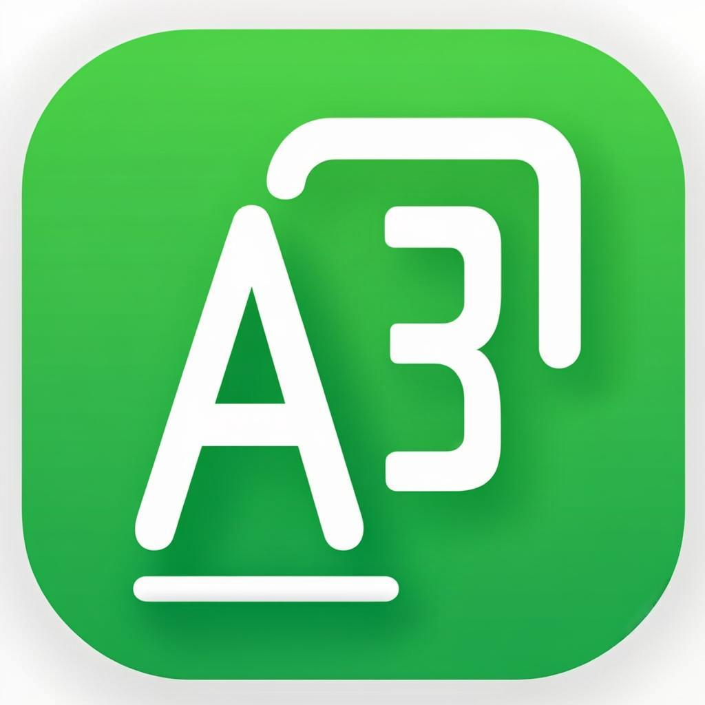
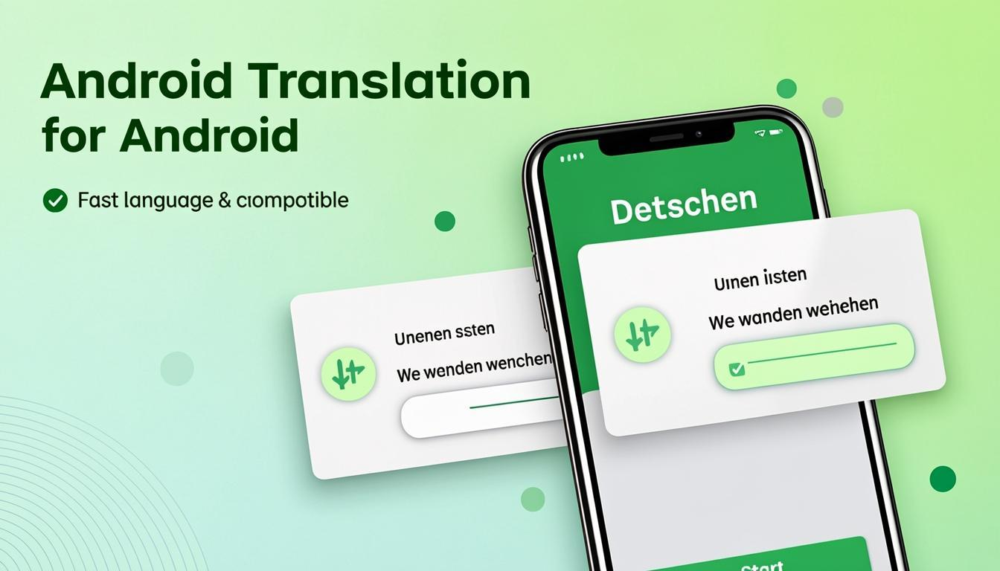

<p align="center">
  
</p>

<h1 align="center">Screen Translator</h1>
<p align="center"><b>Translate German on-screen text into your language — in near real-time, from a Quick Settings tile.</b></p>

<p align="center">
  <a href="https://github.com/AutomatedLabor/translation-app/actions/workflows/build.yml"></a>
  <a href="https://github.com/AutomatedLabor/translation-app/releases/latest"></a>
  <a href="LICENSE"></a>
  
  
  
</p>

<p align="center">
  <a href="#features">Features</a> •
  <a href="#screenshots">Screenshots</a> •
  <a href="#how-it-works">How it works</a> •
  <a href="#install">Install</a> •
  <a href="#architecture">Architecture</a> •
  <a href="#security">Security</a> •
  <a href="#verify">Verify</a> •
  <a href="#build">Build</a> •
  <a href="ROADMAP.md">Roadmap</a> •
  <a href="#license">License</a>
</p>

<p align="center"></p>

---

An Android **AccessibilityService** app that reads German text on the current screen via the
accessibility tree (bypassing `FLAG_SECURE` black screens), translates it **on-device** with
ML Kit (no cloud, no account, no network after the one-time model download), and renders the
result as rounded cards directly on top of the original German — triggered from a **Quick
Settings tile**. Supports **Android 7.0+ (API 24)**.

## Features

- **Android 7.0+ support** (minSdk 24) — installs on any phone from Android 7 onward.
- **12 target languages** — German → English / Urdu / French / Spanish / Italian / Portuguese
  / Russian / Arabic / Turkish / Hindi / Chinese / Japanese. Pick in the app; the tile picks
  up the change live.
- **On-device ML Kit translation** — no cloud, no account; private + works offline after the
  one-time (~30 MB) model download.
- **Bypasses `FLAG_SECURE`** — accessibility node traversal reads text directly, so it works
  in banking / DHL / parcel-tracking apps that block screenshots.
- **No overlay permission** — uses `TYPE_ACCESSIBILITY_OVERLAY` (a trusted window type for
  accessibility services); no `SYSTEM_ALERT_WINDOW` needed.
- **Smart pre-filtering** — skips pure numbers, dates, tracking codes, URLs, emails, and
  confidently-English text (via ML Kit Language ID) so only genuine German prose is translated.
- **LRU cache (500 entries)** for sub-5ms repeat translations.
- **Auto-dismiss** — scroll, switch apps, or tap the ✕ button to dismiss the overlay.
- **Two APK variants** (ABI splits + R8): **arm64-v8a (~20 MB)** for 64-bit ARM phones
  (~99% of devices) + **universal (~67 MB)** for 32-bit / x86 emulators.
- **50 JVM unit tests** + lint + gitleaks secret scan in CI.

## Screenshots

> Real device screenshots will be added. The hero above is a concept render. The setup screen
> (Compose Material 3) has three cards: Accessibility Service status, Target Language picker,
> Offline Model download + test, plus Quick Settings tile instructions.

## How it works

1. You tap the **"Translate Screen"** Quick Settings tile while a German app is open.
2. `TranslatorAccessibilityService` picks the topmost application window (excluding its own
   overlay + the launcher), walks the `AccessibilityNodeInfo` tree (max depth 30, max 500
   nodes), collects text regions, filters out non-German noise, and groups adjacent text into
   line blocks.
3. ML Kit translates each block from German to your chosen target on-device (cached).
4. The translated text is rendered as **rounded cards directly on top of the original German**
   via a `TYPE_ACCESSIBILITY_OVERLAY` window (full-screen, non-touchable so touches pass
   through to the app underneath).
5. A separate 48dp tappable **✕ close button** is drawn at the top-right.
6. Scrolling, switching apps, or tapping ✕ dismisses the overlay; the tile flips back to
   inactive.

> [!NOTE]
> On **Android 7-10 (API 24-29)** the notification shade does NOT auto-collapse after you tap
> the tile (`GLOBAL_ACTION_DISMISS_NOTIFICATION_SHADE` is API 30+). Manually swipe the shade
> away; the overlay then appears. On Android 11+ the shade auto-collapses.

## Install

**Pick the right APK:**

| APK | Size | For |
|---|---|---|
| `screen-translator-…-arm64-v8a-release.apk` | ~20 MB | **Any 64-bit ARM phone (~2017+)** — Pixel, Samsung, OnePlus, Xiaomi, etc. Try this first. |
| `screen-translator-…-universal-release.apk` | ~67 MB | 32-bit ARM phones (pre-2017), x86 emulators, rare x86 devices. Fallback if arm64 fails with `INSTALL_FAILED_NO_MATCHING_ABIS`. |

Download from the **[latest release](https://github.com/AutomatedLabor/translation-app/releases/latest)**.

**Steps:**

1. **If you have v1.0.0 or v1.0.1 installed, uninstall it first** (the signing key changed in
   v1.1.0). v1.1.0+ users can update in place (same key).
2. Download the arm64-v8a APK to your phone. Tap to install → accept **"Unknown sources"**.
3. **Android 13+:** long-press the app icon → App Info → ⋮ → **"Allow restricted settings"**
   (unblocks the Accessibility toggle for sideloaded APKs).
4. **Settings → Accessibility → Screen Translator → enable.**
5. Open the app → **pick a target language** → tap **"Download model"**.
6. Pull down the Quick Settings shade twice → edit → drag the **"Translate Screen"** tile in.
7. Open any German app → pull down the shade → tap **"Translate Screen"**.

## Architecture

```
com.translator.screen/
├── App.kt                              — Application
├── ui/MainActivity.kt                  — Compose Material 3 setup (accessibility / target language / model / tile cards)
├── service/
│   ├── TranslatorAccessibilityService  — host: window pick, snapshot, translate, overlay, live target switch
│   ├── QuickTileService                — thin tile trigger, state sync, unlockAndRun (API 26+)
│   └── OverlayManager                  — two TYPE_ACCESSIBILITY_OVERLAY windows (translation canvas + close button)
├── extract/
│   ├── BoundingBox, ScreenTextRegion, TranslatedTextRegion
│   ├── IScreenTextExtractor
│   └── ScreenTextExtractor             — DFS walk, dedup, spatial line grouping (max 500 nodes)
├── translate/
│   ├── ITranslationEngine              — targetLanguageTag contract
│   └── MlKitTranslationEngine          — German→target, language-id filter, LruCache(500), close-safe
└── util/
    ├── PackageUtils                    — launcher package detection
    ├── LanguagePrefs                   — SharedPreferences for target language
    └── TargetLanguages                 — the 12 supported targets
```

**Stack:** Kotlin 2.0.21 · AGP 8.5.2 · Gradle 8.9 · Jetpack Compose (BOM 2024.09.00) + Material 3 ·
ML Kit `translate:17.0.3` + `language-id:17.0.6` · `kotlinx-coroutines` 1.8.1 ·
minSdk 24 / targetSdk 35 / compileSdk 35.

## Security

- **Dedicated release signing key** (`CN=Screen Translator Release, O=AutomatedLabor`, RSA 2048,
  25y) stored as encrypted GitHub Secrets — NOT the public debug key.
- **v2+v3 APK signing** (forced via `apksigner sign` from unsigned in CI) — v2 covers Android 7-8,
  v3 covers Android 9+. CI fail-closed: rejects any APK not signed with the release key + matching
  the pinned cert SHA-256 baseline (`a0b5e5…7fa2`, rotation detection).
- **`allowBackup=false`** + `data_extraction_rules.xml` (exclude every domain from backup/transfer)
  + `network_security_config.xml` (block cleartext app-wide) — the service reads screen contents,
  so nothing leaves the device.
- **R8 minification + obfuscation** on release.
- **gitleaks secret scan** fail-closed in CI.
- **Gradle wrapper jar validated** in CI (supply-chain).

## Verify

The release ships a signed APK + a SHA-256 sidecar + `apksigner-verify.txt` (CI's proof). Use
`apksigner verify` (NOT `keytool -printcert` — v1-only, false "Not a signed jar file" on v2/v3
APKs):

```
apksigner verify --print-certs --verbose screen-translator-…-arm64-v8a-release.apk
# expect: Verifies, v2=true, v3=true,
#         Signer #1 certificate DN: CN=Screen Translator Release, O=AutomatedLabor, C=US
#         Signer #1 certificate SHA-256 digest: a0b5e5f35ee134d2816a24cc467297b3024ea466f1d5d98c0104b3e8b7e27fa2
sha256sum -c screen-translator-…-arm64-v8a-release.apk.sha256
```

See [INSTALL.md](https://github.com/AutomatedLabor/translation-app/releases/latest) in the latest
release for the full step-by-step + the changelog across v1.1.0 → v1.5.0.

## Build

```bash
./gradlew :app:assembleRelease      # release APK(s) — ABI splits + R8
./gradlew :app:assembleDebug        # debug APK
./gradlew :app:testDebugUnitTest    # 50 JVM unit tests (Robolectric + Truth)
./gradlew :app:lintRelease          # lint report
```

Requirements: JDK 17, Android SDK with `platforms;android-35` + `build-tools;35.0.0`. The CI
workflow (`.github/workflows/build.yml`) handles signing (from secrets) + zipalign +
`apksigner sign` (v2+v3) + verify.

## Roadmap

See [ROADMAP.md](ROADMAP.md) for the living roadmap (done / in-progress / deferred with rationale).

## Contributing

This is a fork of [`mahadhameed095/translation-app`](https://github.com/mahadhameed095/translation-app),
maintained at [`AutomatedLabor/translation-app`](https://github.com/AutomatedLabor/translation-app).
PRs welcome. Run `./gradlew :app:testDebugUnitTest` + `lintRelease` before submitting.

## License

[MIT](LICENSE) © AutomatedLabor. The original app is © mahadhameed095.
